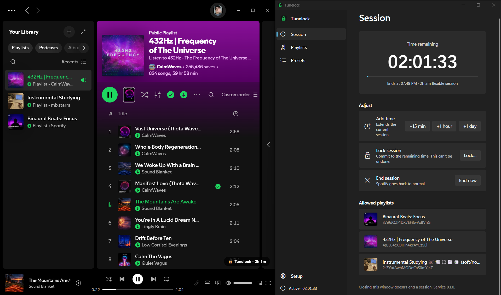

# Focus Lock for Spotify

**Focus lock for the Spotify desktop app on Windows.** Pick how long you want to focus, and Spotify is reduced to the playlists you allowed (for example, a binaural-beats playlist and an instrumental one) until the timer runs out.

> Status: early development (v0.1). The installer works, but it isn't signed yet, so Windows SmartScreen warns on first run.

## Why

Website and app blockers like Cold Turkey can only block Spotify entirely. Focus Lock keeps the Spotify desktop app open but restricted to an allowlist (whitelist) of playlists, so you can block everything else, such as search, recommendations and other playlists, while you study or focus.

## Features (v0.1)

- Timed focus sessions measured in hours or days.
- **Locked mode:** once started, the session cannot be cancelled until it ends.
- **Flexible mode:** start and stop with one click.
- Spotify shows only your allowed playlists. Search, home, library and recommendations are hidden.
- Presets such as "Study 10 h" or "Exam week 5 days". Recurring schedules come in v0.2.
- Closing the app does not end the session, because it runs in a background Windows service.

## Install

1. Install the Spotify desktop app from [spotify.com](https://www.spotify.com/download/). The Microsoft Store version is not supported.
2. Download `FocusLock_<version>_x64-setup.exe` from the [Releases](../../releases) page and run it. It asks for administrator rights because it installs a Windows service.
3. Open Focus Lock. The Setup page installs Spicetify and the Focus Lock extension if they are missing.
4. Pick your allowed playlists and start a session.

## Usage



- **Playlists:** add the playlists Spotify may show and play during a session.
- **Session:** choose a duration and a mode, then start. A locked session cannot be cancelled before it ends, and you can only add time to it.
- **Presets:** save durations you use often, such as "Study 10 h".
- **Setup:** shows whether Spotify, Spicetify and the Focus Lock extension are ready, and fixes what is missing.

Focus Lock also has a command-line tool, `focuslock`, with the same controls (run `focuslock --help`).

## How it works

- `focuslock-service` is a Windows service written in Rust. It owns the session state and the timer.
- A [Spicetify](https://spicetify.app) extension restricts the Spotify desktop client while a session is active.
- A desktop app built with Tauri provides the UI. Closing it does not end a session.

See [`docs/plan.md`](docs/plan.md) and [`docs/adr/`](docs/adr/) for the design.

## Limitations

- Windows only, with the Spotify desktop app from spotify.com. The Microsoft Store version is not supported by Spicetify.
- Focus Lock adds strong friction, but it is not meant to be impossible to remove for an administrator of their own machine.
- Modifying the Spotify client is against Spotify's Terms of Use. Use it at your own risk.

## Build from source

You need Rust, Node.js with pnpm, and, to cross-build the Windows installer from Linux or WSL, `cargo-xwin` plus the `llvm`, `clang`, `lld` and `nsis` packages.

```sh
cargo fmt && cargo clippy --all-targets -- -D warnings && cargo test
cd extension && pnpm install && pnpm typecheck && pnpm test && pnpm build
./scripts/build-installer.sh
```

[`AGENTS.md`](AGENTS.md) lists every command and the layout of the repository, and is the place to start before contributing. Changes should keep the rules in it, in particular that a locked session can never become weaker.

## Project status and support

Focus Lock is a personal project maintained in spare time. It comes without warranty and without support guarantees. Issues and PRs are welcome, but responses may be slow.

## License

[GPL-3.0](LICENSE).

Focus Lock is an independent project. It is not affiliated with, endorsed by or sponsored by Spotify AB, Spicetify or Cold Turkey. Spotify is a trademark of Spotify AB, and Cold Turkey is a trademark of its owner. They are named here only to say what Focus Lock works with.
